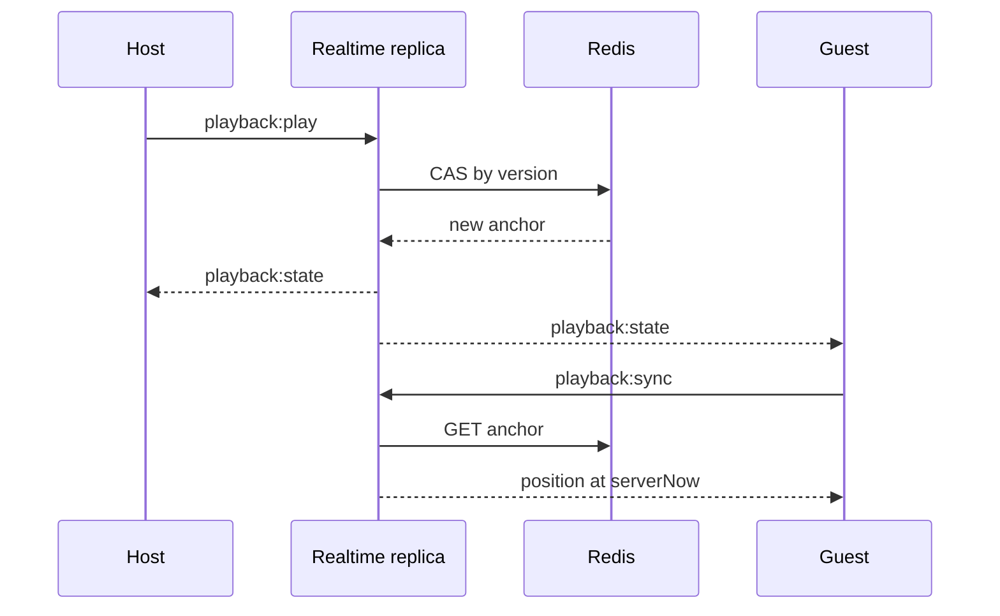

# Архитектура

Четыре процесса и общие пакеты. Клиент не держит правду о воспроизведении.



## Часы

Якорь: `status`, `anchorPositionMs`, `anchorServerTimeMs`, `version`, `updatedBy`.

- `playing`: позиция = якорь + прошедшее серверное время.
- `paused`: позиция = якорь.
- `play` / `pause` / `seek` двигают якорь и увеличивают версию. Повторный `play` во время `playing` ничего не пишет.
- `clock:ping` возвращает `t0`, `t1`, `t2`. Клиент может оценить сдвиг `estimateClockOffset`. Сдвиг не двигает якорь: авторитет остаётся у сервера.

Пишет только `host`. Хост — первый `room:join` (`SET NX` на ключе хоста). Смена хоста — фаза 2.

## Redis — источник правды

| Ключ | Смысл |
| --- | --- |
| `lume:room:{id}:host` | userId хоста |
| `lume:room:{id}:presence` | hash участников |
| `lume:room:{id}:playback` | JSON якоря |

Запись якоря — Lua compare-and-set по `version`. Проигравшая попытка отвечает `version_conflict`.

`Map` внутри процесса хранит только `socket.id → { roomId, userId }`, чтобы снять участника на `disconnect`. После падения процесса эта связь пропадёт, ключи в Redis останутся. Уборку сделает worker позже.

Без `REDIS_URL` realtime не подключается к localhost сам. `/health` = 200, `/ready` = 503, join получает `redis_unavailable`.

## Room-hash routing

```
ownerIndex = FNV-1a(roomId) % REALTIME_REPLICA_COUNT
```

Адаптер Socket.io через Redis доставляет события на все реплики, поэтому читать комнату может любая. Индекс нужен, когда записей много и их надо прижать к одному процессу: `REALTIME_ENFORCE_ROOM_OWNER=true`. Чужая реплика отвечает `not_owner` и `ownerIndex`. Клиенту тогда стоит открыть сокет на эту реплику. Пока реплика одна, флаг выключен.

Функции `roomHash`, `replicaForRoom`, `foreignOwnerIndex` лежат в `@lume/contracts` и покрыты тестом на стабильные значения.

## Комната

`POST /auth/dev` (только `ALLOW_STUB_AUTH`) или `POST /auth/telegram` создаёт `User` и JWT. Мутации комнаты требуют `Authorization: Bearer`. Сокет принимает тот же токен в `handshake.auth.token` и не верит `userId` из события.

`POST /rooms` создаёт зал и членство хоста. `POST /rooms/join` с кодом (`slug`) сажает зрителя, пока активных меньше 25. `GET /rooms` отдаёт открытые залы. `POST /rooms/:id/leave` ставит `leftAt`. Роли: `host`, `mod`, `viewer`.

Чат и очередь пишет realtime, вызывая API, и тут же рассылает событие. Сообщения и реакции лежат в Postgres. Очередь — `QueueItem`. «Дальше» ставит следующий элемент в `Room.nowPlayingId` и сбрасывает якорь на паузу в начале. Присутствие и якорь по-прежнему в Redis.

## API

| Метод | Путь | Поведение |
| --- | --- | --- |
| GET | `/health` | процесс жив |
| GET | `/ready` | какие секреты заданы, без пинга базы |
| POST | `/auth/telegram` | HMAC initData, если есть токен бота. Иначе 501, либо stub при `ALLOW_STUB_AUTH` |
| POST | `/auth/token` | выпуск JWT только при `ALLOW_STUB_AUTH` и `JWT_SECRET` |
| POST | `/voice/livekit/token` | 503 `livekit_disabled`, пока не заданы URL, key и secret |

Проверка initData: secret = HMAC-SHA256(ключ `WebAppData`, сообщение = токен бота), затем HMAC data-check-string. `auth_date` старше суток отклоняется.

Пользователь в ответе имеет id `tg:{telegramId}`. Запись в Postgres — следующая фаза, клиент Prisma уже экспортируется из `@lume/db`.

## Экстракторы

`MediaExtractor` остаётся пустым. `media.resolve` возвращает `no_extractor`, пока переменная `FF_EXTRACTORS` не равна `true` или `1`. Даже с флагом реестр пуст: yt-dlp в эту фазу не входит. Матрица embed-плееров — в [PLAYERS.md](PLAYERS.md).

## База

Prisma schema: `User`, `Session`, `Room`, `RoomMember`, `Friendship`, `Message`, `Reaction`, `Achievement`, `UserAchievement`, `NotificationPreference`, `Entitlement`. Миграция `packages/db/prisma/migrations`. `pnpm db:migrate` вызывает `prisma migrate deploy`.

`layout` комнаты — JSON формы `RoomLayout` версии 1. `kind` уведомления — строка, чтобы не мигрировать схему на каждый новый тип.

## English

Redis is the room source of truth. Socket.io fans events out. A room hash picks a preferred writer only when `REALTIME_ENFORCE_ROOM_OWNER` is set. Playback is an anchor plus server time, CAS-guarded by version. The API can mint a Telegram-backed JWT and a LiveKit token once those secrets exist. Media extractors are an interface with an empty registry.
